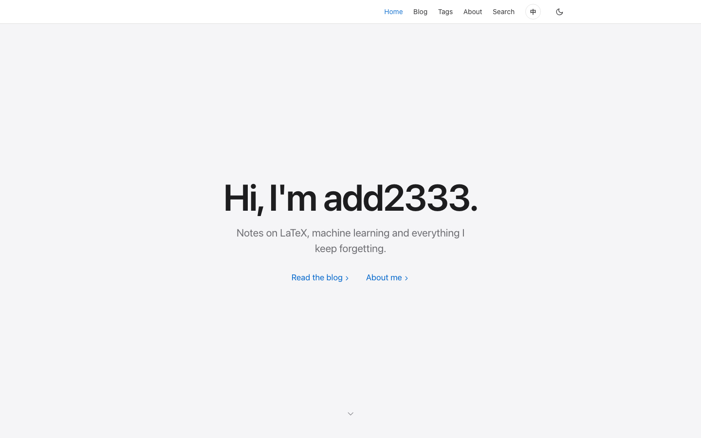
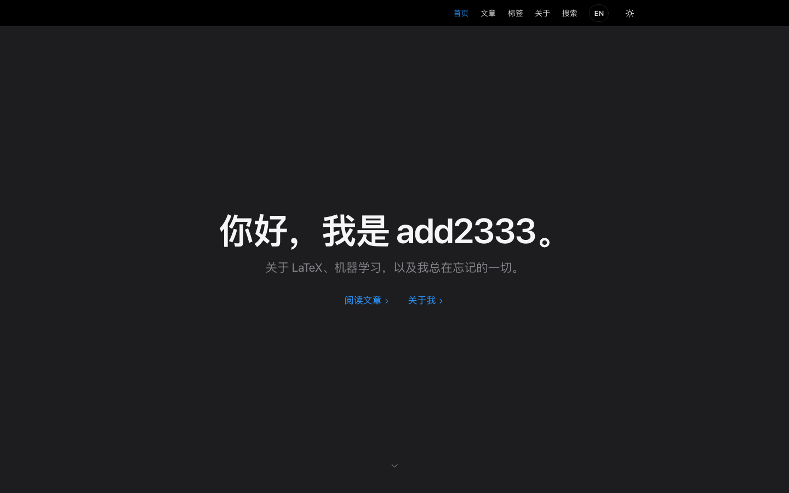
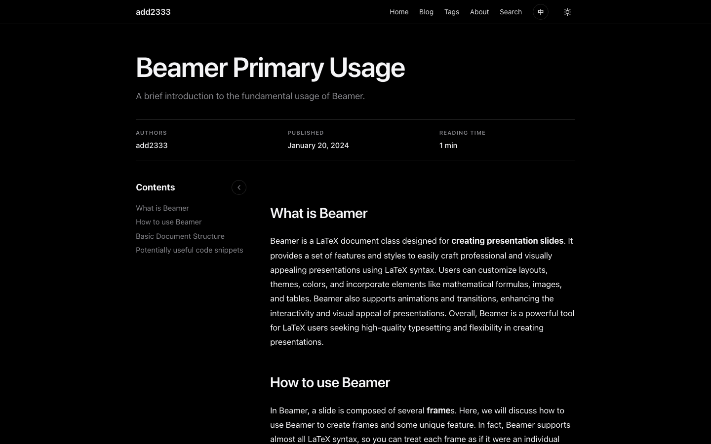

# hahaha blog

用 **Astro 7** 重写的个人博客，纯静态输出（零框架运行时 JS）。视觉上走 Apple
官网那套排版语言：白 / `#f5f5f7` 两种表面色，近黑的 `#1d1d1f` 字色，全局只有一个
蓝色强调色，大号半粗标题配克制的灰底卡片；深色模式反转为纯黑 `#000` + `#1d1d1f`
卡片。左侧目录可以向侧面折成一条细轨（正文会自动重新居中并变宽），界面支持中英文
切换。







首页结构参考了几个写得干净的独立博客（[robinsloan.com](https://www.robinsloan.com/)、
[muan.co](https://muan.co/)、[blog.jim-nielsen.com](https://blog.jim-nielsen.com/)、
[sive.rs](https://sive.rs/)、[craigmod.com](https://craigmod.com/)）：第一屏只留一句
问候和两个链接，文章列表往下让位，不堆装饰。

## 快速开始

```bash
npm install
npm run dev        # http://localhost:4321
npm run build      # 产出 dist/，并跑一遍 Pagefind 生成搜索索引
npm run preview    # 本地预览 dist/
```

> 搜索索引是 `npm run build` 里的 Pagefind 生成的，所以 `npm run dev` 下 `/search/`
> 还没有索引（页面会显示一行提示）。要试搜索：`npm run build` 后预览 `dist/`。
> 只有带 `data-pagefind-body` 的文章页会被索引，标签页/列表页不会污染搜索结果。

## 目录结构

```
src/
├─ content/blog/        # 文章（Markdown + front matter），一篇一个文件
├─ content.config.ts    # front matter 的校验规则（zod）
├─ i18n.ts              # 界面文案的中英对照表 + t()/both() 取词函数
├─ layouts/             # Base（外壳）/ Post（文章页）
├─ components/          # 导航、页脚、文章列表、目录、主题/语言切换
├─ pages/               # 路由：首页、/blog/、标签、分类、搜索、RSS、404
├─ styles/global.css    # 全部样式与设计变量，只有这一个文件
└─ utils.ts             # slug、日期、阅读时长等小工具
public/                 # 原样拷贝的静态资源
scripts/import-legacy.py# 从旧站 HTML 反推 Markdown 的转换脚本
```

## 写一篇文章

新建 `src/content/blog/<name>.md`：

```markdown
---
title: "文章标题"
description: "列表页显示的一句话摘要"
date: 2026-10-18
updated: 2026-10-20      # 可选
authors: ["add2333"]     # 可选，默认 add2333
affiliations: []         # 可选，非空时详情页会多一列
tags: ["LaTeX"]          # 可选，URL 会自动 slug 化成 /tags/latex/
categories: ["tools"]    # 可选
permalink: "tools/beamer" # 可选：手动指定 URL，不写则用文件名
draft: false             # true 时不出现在任何列表和构建产物里
---
```

正文就是普通 Markdown：`##`/`###` 标题会自动进左侧目录，代码块用 Shiki 高亮
（跟随明暗主题），数学公式用 `$...$` / `$$...$$`（KaTeX），行内代码、表格、
引用都有样式。

## 首页的滚动交接动效

首页（`src/pages/index.astro`）第一屏只有问候语，不列文章：`.hero-shell` 撑出
`100svh + 62svh` 的高度，里面的 `.hero` 用 `position: sticky` 钉在导航栏下方，于是
往下滚时英雄区是不动的，文章列表从下面顶上来（`.home-content` 用 `margin-top: -40svh`
提前露头，开头不会有空屏）。

滚动过程中 JS 只改三样东西：

- `#hero` 里那个 `.hero__name`（也就是 `add2333`）的 `translate` + `scale`：把名字送回
  导航栏站点标题那一格。落地位置是量出来的——`scale = 站点标题字号 / 英雄区字号`，
  位移取两者中心点之差，字距也一起插值，所以到达那一刻和 `.navbar__brand` 完全重合；
  最后 12% 的进度里两者交叉淡入淡出，看不出是在换元素。
- `--hero-copy` / `--hero-lead` 两个 CSS 变量，用来淡出问候语的前后缀和一句话简介
  （纯 CSS 读变量，JS 不碰具体元素）。

时间轴（`paint()` 里的四个进度阈值）：简介和链接在 16%→54% 处淡出并轻微上移，
「Hi, I'm」与句号在 10%→42% 处淡出，名字从 10% 开始飞、到 90% 落位，缓动是
`smoothstep`（先加速再减速，像 Apple 的转场而不是「弹一下」）。

滚动距离取 `min(粘住可用行程 × 0.86, 列表顶部 − 66vh)`——上限保证名字一定在英雄区
解钉之前落位，下限让「信纸升起」和「名字归位」几乎同时完成。几何量会在 `resize`、
切换语言/主题时重新测量；如果那时页面已经滚过粘住区间，测量会先把 `overshoot` 加
回去（否则 `dy` 会偏一整段行程）。JS 没跑或 `prefers-reduced-motion: reduce` 时
`--hero-extra` / `--hero-overlap` 保持 0、站点标题照常显示，页面退化成普通的一屏问候。

第一屏的背景就是一块 `--bg-soft` 灰面：不放渐变光晕，也不用点阵纹理，只有居中的
标题、一句灰色简介、两个带 `›` 的蓝色链接和底部一个小小的 `⌄`。留白和字重对比负责
观感，动效负责叙事；`.home-content` 用 `--bg` 白底压在灰面上，滚动时是「白纸升起」
而不是「一块背景退场」。

## 目录折叠与中英文切换

目录（`src/components/Toc.astro`）右上角有一个圆形按钮：宽屏下点击会把整条目录折成
一条细轨，正文宽度平滑过渡并重新居中（`global.css` 里 `.post-body` 同时过渡
`--toc-width` 和 `padding-right`，右内边距镜像左侧轨道宽度，所以折叠后文章仍然居中）。
窄屏下同一个按钮改成正向折叠。状态存在 `localStorage.toc`，没有手动选过时跟随 1000px
断点。

语言按钮把 `document.documentElement.dataset.lang` 设成 `zh`/`en`，纯 CSS 决定显示
哪一份文案：

```astro
<Lang en="All posts →" zh="全部文章 →" />   <!-- 静态文案 -->
<Lang en={blurb.en} zh={blurb.zh} />        <!-- 文案表里的动态文案 -->
```

文案表在 `src/i18n.ts`（`ui.en` / `ui.zh`）。`both("minRead", { n: 3 })` 一次取出两种
语言，`t("zh", "minRead", { n: 3 })` 取单语；日期、阅读时长这些都输出两份，所以不需要
运行时替换 DOM 文案。按钮的 `aria-label` / `title` 走 `data-label-en` /
`data-label-zh`，由 `LangToggle.astro` 的脚本统一刷新。

首次访问的语言取自 `localStorage.lang`，没有时看 `navigator.language`（中文系统直接进
中文）。文章标题和正文不参与翻译——想写中文文章直接写中文即可。

## URL 与旧站对应

旧站（Hugo + PaperMod）的地址全部保持不变：

| 旧 URL | 新 URL |
| --- | --- |
| `/tools/beamer/` | 同左 |
| `/retrospectives/retro_of_2024_mcm_icm/` | 同左 |
| `/tags/latex/`、`/tags/retro/` | 同左 |
| `/categories/tools/`、`/categories/retro/` | 同左 |
| `/index.xml`（RSS） | 保留，同时新增 `/rss.xml` |
| `/sitemap.xml` | 保留（指向新的 `sitemap-index.xml`） |

## 元信息与无障碍

`Base.astro` 里除了 canonical / RSS，还输出一套社交分享标签：`og:image` 指向
`public/og.png`（1200×630：`#f5f5f7` 底、居中的问候语和一句灰色简介，就是首屏的
静态版），`twitter:card` 用 `summary_large_image`，并带上 `og:site_name`、
`og:locale` 与中英双语 `og:locale:alternate`。文章页通过 `Base` 的 `head` 具名插槽
额外注入一段 `BlogPosting` 结构化数据（标题、摘要、作者、发布/更新日期、所属 Blog），
搜索引擎可以据此显示作者和日期。

另外两个小决定：

- 浅色主题的 `--accent` 用 Apple Blue `#0066cc`（白底 5.6:1），深色主题换成
  `#2997ff`；`--text-muted` 取 Apple 自己的 `#6e6e73`（白底 5.1:1、灰底 4.8:1），
  正文链接和次要文字都满足 WCAG AA。
- `:root` 声明 `color-scheme`，深色主题下滚动条、表单控件跟着变深；
  `prefetch: { prefetchAll: true, defaultStrategy: "hover" }` 让鼠标划过内链时预取目标
  页面，站内跳转几乎瞬时；触屏设备上代码块的 copy 按钮不再依赖 `:hover`（`@media
  (hover: none)` 下常显）。

## 部署

`.github/workflows/deploy.yml` 会在 push 到 `main` 时构建，并把 `dist/` 推送到
`add2333/add2333.github.io`。启用前需要在仓库 Secrets 里加一个 `GH_PAGES_TOKEN`
（classic PAT，勾选 `repo`）。

不想用 Actions 的话，本地构建后手动同步即可：

```bash
npm run build
rsync -a --delete dist/ ../add2333.github.io/
cd ../add2333.github.io && git add -A && git commit -m "deploy" && git push
```

## 从旧站迁移

旧仓库里只有 Hugo 的构建产物（`hahaha-blog/public/`），没有 Markdown 源码，
所以两篇文章是从渲染后的 HTML 反推回来的：

```bash
git clone https://github.com/add2333/add2333.github.io /tmp/legacy
python3 scripts/import-legacy.py /tmp/legacy src/content/blog
```

转换脚本会处理标题、段落、列表、链接、代码块（含语言标记），日期/标签/分类需要
自己确认一遍。

## Hugo → Astro 对照

| Hugo | 这里 |
| --- | --- |
| `config.toml` | `astro.config.mjs` |
| `content/` | `src/content/blog/` |
| `archetypes/` | 直接复制上面那坨 front matter |
| `layouts/` + 主题 | `src/layouts/`、`src/components/` |
| `hugo server` | `npm run dev` |
| `hugo` + 手动 copy `public/` | `npm run build`（含搜索索引） |
| `{{ .Title }}` 之类模板语法 | JSX 风格的 `.astro` 组件 |

五篇文章以内的小站，改主题就是改 `global.css` 和几个 `.astro` 文件，没有隐藏魔法。
